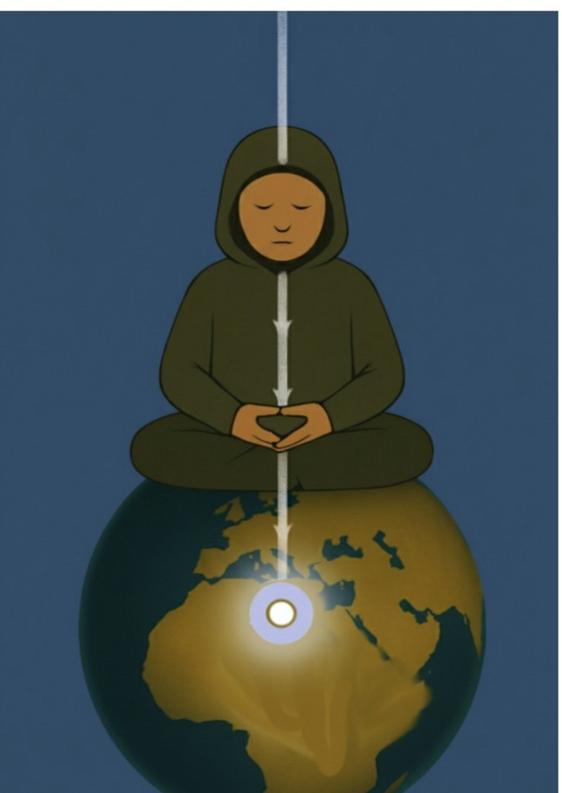
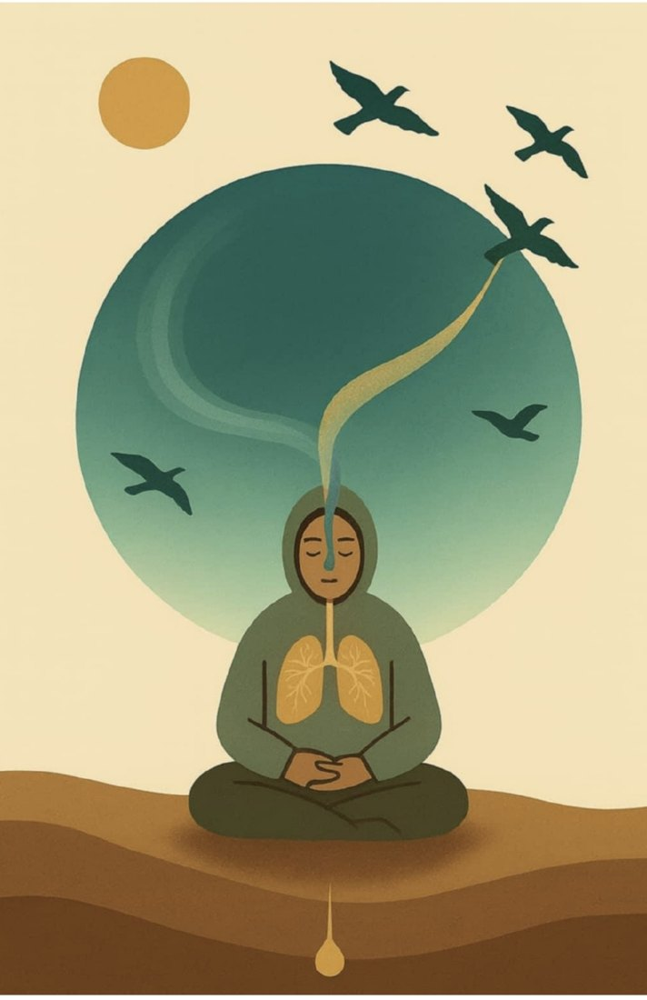
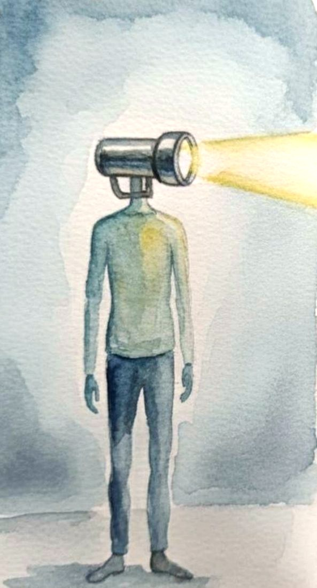
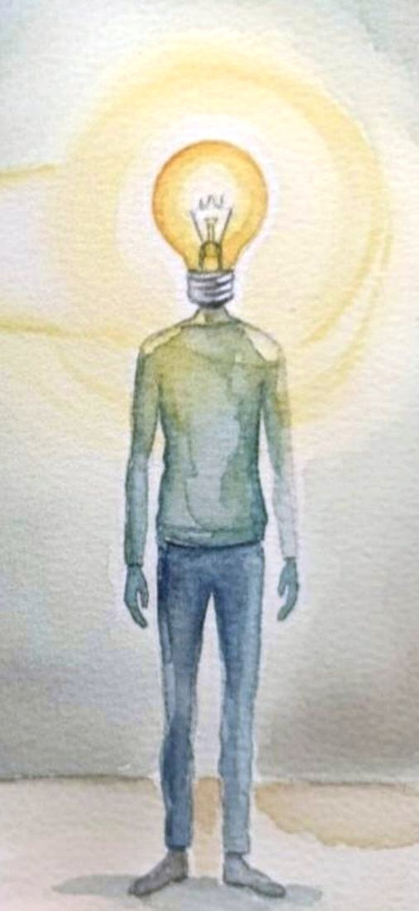

# A Mindfulness Guide for Neurodivergents

## Presence Practice Workbook

*Based on the Fourfold Axis: Body · Breath · Attention · Space*

**Theodoros Bairaktaris**

© 2025–2026 · CC BY-NC-ND 4.0 · Second edition

---

Author: Theodoros Bairaktaris
Edition: Second edition, 2026

This work is offered free of charge under the terms of the Creative Commons
Attribution-NonCommercial-NoDerivatives 4.0 International License (CC BY-NC-ND 4.0).
Sharing is permitted with attribution to the creator. Commercial use and
modification are not permitted.

> **A note before you begin.** The exercises that follow are tools for
> self-regulation. They do not replace therapy, diagnosis or medication. If at any
> point your emotions overwhelm you, or you feel intense discomfort, stop the
> exercise, open your eyes and feel your soles on the ground. The support of a
> therapist can prove valuable. The practice of presence has compassion at its core.

---

# Table of Contents

**Introduction**

- Who Is This Book For?
- A Note on the Wisdom of the Body
- Personal Note
- How We Define Mindfulness
- How to Use This Guide

**Part 1: The Core of the Method**

- Ch. 1 – Body: The Stability of "Here"
- Ch. 2 – Breath: The Rhythm of Life
- Ch. 3 – Attention: The Lens of Consciousness
- Ch. 4 – Space: Open Awareness

**Part 2: Applications & Transformation**

- Ch. 5 – The Neurodivergent Mind
- Ch. 6 – Self-Regulation in Daily Life
- Ch. 7 – The New Driver: Avoidance and Procrastination
- Ch. 8 – When the Wave Rises
- Ch. 9 – Presence Worksheet
- Ch. 10 – The Four Stages: Step-by-Step Guide
- Ch. 11 – The Background: Science and Wisdom

**Supplementary**

- 7-Day Practice Journal
- Glossary
- Appendix — The Rabbit Hole
- Epilogue

---

# Introduction

## Who Is This Book For?

This guide is for those who feel disconnected: those whose mind races without
pause, whose body lives in constant alertness, and for whom calm feels like a
foreign language.

It is a tool for people who live with the impact of trauma, with neurodivergence
(such as ADHD), or simply with the chronic pressure of modern life.

You do not need to "fix" anything in yourself, because nothing is broken. The goal
is to learn to return, gently and kindly, to your living presence.

## A Note on the Wisdom of the Body

The mind has no sense of "now". It travels ceaselessly between memories of the
past and projections of the future. The body, by contrast, through undeniable
gravity and the breath, is always here. For those of us who have felt
disconnected, returning to the present is not merely a psychological exercise but
an embodied journey of reconnection.

## Personal Note — A Journey, Not a Theory

This guide was not born in a laboratory or an academic office. It was born of a
personal need. When my son received his diagnosis, I realised that I am
neurodivergent too. Only, in my day, they called me "hyperactive".

We needed something practical: a method of self-regulation that does not ask us to
fight our brain, but to work with it. I turned to mindfulness, because I had read
that it helps. The modern methods I found were built to the measure of a mind that
did not resemble mine. So I set out to find their source — and I knew how to look,
because esotericism had been my special interest since childhood.

There I found the opposite of what I expected. The sources were not asking for a
quiet mind. They were offering a method for meeting your own mind as it is and
reconnecting with it. That was precisely what had fallen away on the road to the
diluted versions — and it was the one thing I needed.

What remained was the translation. Not of the method, but of its shape: these
traditions assume time, stillness, a teacher in the room, years of gradual
practice. And they do not answer questions that were never put to them — sensory
overload, hyperfocus, a system that shuts down. What holds from these exercises
when attention settles nowhere, when the body is already overloaded, when stillness
is itself the discomfort.

This is the book. I am not a teacher. The practice came from elsewhere; the
translation is mine, and so is the responsibility for it.

> "My mind didn't stop racing, but it stopped carrying me away."

## How We Define Mindfulness

Mindfulness is not a mysterious "something" to be achieved. It is the natural
experience that arises when the four main centres of consciousness function
simultaneously and in harmony.

- **BODY** — The sense that you inhabit a body that touches, feels and connects to
  the earth through gravity.
- **BREATH** — Awareness of the rhythm of your life, the continuous flow of inhale
  and exhale that connects you to the world.
- **ATTENTION** — The ability to direct the light of your awareness: to focus, to
  open or to observe.
- **SPACE** — The sense of the open field within and around you, in which thoughts,
  feelings and sensations appear and disappear.

When you are under pressure or scattered, these centres may function separately or
even in conflict. The method that follows is simple: to come into contact with each
centre on its own and then attune them so that they work in parallel.

You do not change yourself. You attune, and make room for what is already there.

## How to Use This Guide

- The exercises have the quality of play. There are no mistakes, only experiments.
- Presence does not need to last hours. It begins with victories of a few seconds.
- The instructions are clear, but do not hesitate to adapt them to your needs.
- Consistency in small doses matters more than duration.

In Chapter 11 and in the resources at the end of the book you will meet names from
contemplative traditions: the sources of the exercises and the teachers who passed
them on. They are cited there as we would cite the researcher behind a study. No
belief is required, and none is proposed. The method stands entirely on
observation and on your own experience.

Each chapter includes **four graduated exercises**, from a single moment to a few
minutes, so that you can begin straight away. The full, structured eight-week
programme is in the app. At the end of the book you will find a **Glossary** with
all the terms of the method. If you meet a word you do not remember, it is there.

> **Companion app.** Every exercise in this book also exists in interactive,
> animated form at [neurodivergent-mindfulness.org](https://neurodivergent-mindfulness.org).
> For sound (binaural beats and calm soundscapes that support regulation) see the
> app's [sound space](https://neurodivergent-mindfulness.org/en/sanctuary). The app
> is free, with no account and no tracking.

---

# Part 1 — The Core of the Method

**The Fourfold Axis: Body · Breath · Attention · Space**

The next four chapters introduce you to the four centres of consciousness that form
the core of this practice. Each chapter includes theoretical background, practical
exercises and space for reflection.

---

## Chapter 1 — Body: The Stability of "Here"

> **In this chapter**
> The body is the undeniable ground of the present moment. You learn to perceive gravity, your posture and your contact with space, as the starting point of every practice.

*Grounding through gravity: our stable base.*

### The Beginning: Relaxation and Grounding

The practice of the Fourfold Axis always begins with the body. The body is your stable base, the undeniable "Here" that connects you with the present. We begin with conscious grounding, because relaxation comes before awareness.

Your body is not just a vehicle. It is a living archive of your experiences. The posture you have formed often carries the rejection, the disappointment and the tension you lived through because you felt different. These experiences get "locked in" as chronic tightness in the shoulders, the back, the pelvis and the jaw.

### Gravity: The Undeniable "Here"

Gravity is not just a force. It is the proof of "Here". It shows you, beyond any doubt, exactly the point where you can exist in space, at this very moment. Grounding is the first act of relaxation.

### Your Goal

- **Not:** to achieve a specific, perfect posture.
- **Not:** to stop your thoughts.
- **Yes:** to be comfortable, grounded and relaxed within your body.

### The Body, Space and the Sense of Safety

Deep relaxation in the body is never an isolated act. It always presupposes awareness of space. Through the senses, your body keeps informing you of your position in space.

When space is perceived as open and welcoming, the body is given permission to let go of tightness and relax. True grounding happens only in a space you feel can hold you. The body and space work together.

### Escaping the Concepts

When the mind has no stable, undeniable base in the present, it often falls into the trap of inner analysis and scenarios. Focusing on gravity gives you a way out of these mental scenarios.

Analysis and observation come in their own time, once stability is there.

This is a good moment to name two functions you will meet throughout this guide. The **Mechanical Mind** is the part of the mind that analyses the past and plans the future: a useful tool, but with no sense of now. The **Open Mind** is its complementary function: it observes without analysing, embraces without judging, sees beyond the scenarios. The content of the Mechanical Mind is recognised and let go, if it is not useful or if it is harmful, without any need for analysis. You will meet both again, in detail, in Chapter 5.

**An undeniable "Here" and a ceaseless flow.** While gravity gives you an unshakeable "Here", on a larger scale there is only movement and flow (like the Earth around the Sun). Mindfulness teaches you to embrace both poles: the stability of gravity and the ceaseless flow of life.

> **An important note on time.** Changing posture and tension takes a good while. The habit was built over years and the body has been moulded. Do not rush and do not push yourself. Persistence in gentleness is the greatest act of self-regulation.

### Practice Exercise: The Book / Box

- **Position:** Stand comfortably upright.
- **Prop (optional):** Take a book or a box and place it on your head.
- **Focus:** Notice how you need to stand so that it does not fall. Feel the weight descend smoothly through the neck, the spine and the pelvis.
- **Sensation:** Feel the weight, the touch of your soles on the ground and the sense of the axis that keeps you upright.

*In the app: Guided grounding exercise · Body microdoses · for movement, Swaying and Cloud Hands (Tai Chi).*

**Reflection:** After the exercise, what did I notice in my body?

### Four Exercises for Earth

From a single moment to a few minutes. Start with whichever suits you.

1. **The drop of weight** *(1 second)* — Wherever you are, stop for a moment and let your weight "drop" towards the earth. That is all.
2. **The soles** *(20 seconds)* — Bring your attention to the soles of your feet. Feel the contact with the ground, the weight spreading, the earth holding you.
3. **The axis** *(1 minute)* — Feel the imaginary vertical line from the crown of your head to your soles. With each exhale, soften your jaw and shoulders around it.
4. **Slow walking** *(2–3 minutes)* — Walk more slowly than usual, feeling each sole touch down and push off. The earth holds you at every step.

> ★ **Key Point:** Gravity is always here. The body is always here. That is enough to begin.

---

## Chapter 2 — Breath: The Rhythm of Life

> **In this chapter**
> The breath connects you with the rhythm of life and teaches the acceptance of impermanence. Every inhale and exhale is a small rehearsal of beginning and ending.

*The breath as a bridge between body and world.*

If the body joins you to the earth, the breath connects you with the air and the ceaseless flow of the world. It is the rhythm that accompanies you from birth to the end.

### The Rhythm of Existence

Observing the breath teaches you the natural rhythm of existence and the acceptance of impermanence. Each inhale is held for a moment and then let go with the exhale.

- **INHALE — The Beginning:** birth, receiving.
- **PAUSE — The Moment:** existing in the now.
- **EXHALE — The Ending:** release, acceptance.

This matters for the neurodivergent mind: when you feel an intense emotion, it can feel permanent. By observing the rhythm of the breath, you learn that every state is passing.

### The Act of Observation — Inner Touch

The first step is acceptance. You do not need to control your breath. It is enough to observe it as it is: deep or shallow, slow or fast, free or tight. Notice:

- The feeling of the air touching the nostrils.
- The expansion and contraction of the chest.
- The movement of the belly.
- The small change in the body's posture with each inhale and exhale.

**The breath as an indicator.** If it is tight or shallow, it shows tension. If it is slow and deep, it shows relaxation. The breath is the indicator of your inner state.

### The Three Rhythms

Throughout this book you will meet three breathing rhythms. They do not compete: each has its own job.

| Rhythm | When | What it does |
|---|---|---|
| **5-5** (inhale 5, exhale 5) | daily, in a neutral state | balance and steadying; restless air becomes a current |
| **4-6** (inhale 4, exhale 6) | at the peak, when the wind picks up | the longer exhale tells the nervous system "we are safe" |
| **4-2-7** (inhale 4, hold 2, exhale 7) | in a quiet moment, for deep relaxation | a pause and a very long exhale; the strongest regulator |

*In the app you will also find the 4-7-8 variation, which works on the same principle as 4-2-7: a long exhale after a pause.*

One rule holds for all three: **the exhale is the tool, not the inhale.** You never need to force the air in.

### Regulating in Intense Anxiety

In moments of intense anxiety or overload, the breath can become a direct tool of regulation. Let the exhale leave through the mouth, a little more slowly and for longer. Allow the belly to soften and draw gently inwards.

### The Winds of Emotion

We have seen the breath as an indicator. But there is a second, old reading too: emotions are winds. They are not ideas in the head; they are weather in the body and in the breath. That is where you can read them, before you find words for them.

- **Anger** — a strong, rising wind: it swells the chest, lifts the breath and makes it shallow.
- **Anxiety** — a wind that keeps changing direction: breath unsteady, short, without rhythm.
- **Sadness** — stillness and damp: the air grows heavy, the breath thins out, with sighs that come on their own.
- **Numbness** — thick fog in still air: breath so faint it is almost forgotten.
- **Calm and joy** — a light, steady breeze: breath deep and unforced. The map does not only show bad weather.

If the question "what are you feeling?" brings you a blank, nothing is missing in you. You were simply asked to translate the weather into words without first being taught to observe it.

**First you read the weather.** What wind is it? Where do I feel it in the body? How long has it been blowing? No "why", no stories. Just the weather, now. Recognition is already regulation: a wind you have seen does not rule you the way a wind you deny is blowing does.

**Then you accompany the wind.** You do not stop it; you give it a rhythm:

- At the peak (anger rising, anxiety getting away from you): **4-6**.
- When it eases a little: **5-5**.
- **Chanting or humming on the exhale:** a long exhale with vibration. The body calms the body. If you already hum instinctively when you are under pressure, you knew this before you read it.

### Gusts, Systems, Climate

An honest word: not all winds obey the same tools.

- **Gusts (minutes):** a sudden irritation, a wave of anxiety. The breath softens them right away.
- **Weather systems (days):** the anger or hurt after a rejection may still be blowing tomorrow. If the breathing does not put it out, you have not failed: this wind has its own duration. Here the goal changes. Not to change the weather, but to keep the boat seaworthy. Food, sleep, a person to talk to, reading the weather again. That is success.
- **Climate (years):** the long patterns that come from far back. They are not solved in a day, and for the deepest ones it is worth having a professional alongside you. But knowing your climate changes what happens in between: when the wind rises out of proportion to its trigger, you do not conclude "something is wrong with me", you recognise "I know this pattern". The pain stays; what goes is the second pain, the confusion and the self-blame.

None of this means you are broken. It means you have weather, like everyone. Now you also have a map.

*In the Rabbit Hole: Learning to Ride the Wind — breath and mind as wind and rider in the tsa lung tradition.*

### Practice Exercise: The Active Return

- **Grounding (Body):** Stand upright or sit comfortably. Feel gravity, the contact with the ground.
- **Awareness (Breath):** Turn your attention to the inhale and exhale. Feel the air touching the nostrils.
- **On the exhale:** Let the belly draw gently inwards, as if letting all the tension out with the air.
- **Acceptance:** Do not try to change the breath. Awareness is enough.
- **Regulation (optional):** If you feel a lot of anxiety, move into the 4-6 rhythm, with the exhale leaving through the mouth.

### The Axis of Presence

Through its movement, the breath strengthens the axis of presence that rests on gravity. It works as a counterweight to the flow of thoughts: while the mind may be racing, the breath keeps the body in the now.

The tool here is twofold: to recognise the rhythm and quality of your breath, and to feel how its movement supports the body–gravity axis, bringing you back against the flow of thoughts.

The breath teaches you to observe without intervening. That ability is the bridge to the next step: Attention.

*In the app: Guided breathing with a moving inhale/exhale guide · Breath microdoses.*

**Reflection:** How was my breath during the exercise? (fast/slow, shallow/deep, tight/free)

### Four Exercises for Air

1. **One breath** *(1 breath)* — Observe a single inhale and exhale, without changing anything. Just see it as it is.
2. **The air at the nostrils** *(30 seconds)* — Feel the cool stream on the inhale, the warmer one on the exhale. Only the point where the air touches.
3. **Soft belly** *(1 minute)* — Let the belly soften. On the exhale, let the air out slowly through the mouth (4-6 rhythm). Feel the belly draw in gently.
4. **Humming on the exhale** *(1–2 minutes)* — Take a quiet inhale and, on the exhale, make a soft "mmm". Feel the vibration. The body calms the body.

> ★ **Key Point:** I observe without intervening. Every breath is a new beginning. The tool is always the exhale.

---

## Chapter 3 — Attention: The Lens of Consciousness

> **In this chapter**
> Attention is the lens of the mind: it can focus, open, scatter or get stuck. You learn to recognise where it is and to bring it back gently, without self-criticism.

*Attention as a lens that lights up the present moment.*

Attention is the third centre of consciousness and the tool that decides where the mind will settle. The body is the base, the breath the rhythm, and attention is the lens that lights up the present moment.

### The Four Forms of Attention

**Closed Attention.** The beam gathers on one point. Useful for concentration. For example, you look steadily at an object.

**Open Attention.** The beam opens and lights up many things at once. You hear the sounds, feel the body, breathe. Everything fits in the same awareness.

**Scattered Attention.** Attention is like a monkey leaping from branch to branch. The aim is not to "kill" it but to rein it in gently.

**Stuck Attention.** The beam gets stuck on an outer object or on mental content: a thought, a worry. Excessive self-reference ("why do I feel like this? what does it mean?") is its typical form. It is the state that deserves the most attention, and the next section is devoted to it.

### The Vicious Circles: "Otherwise" and "Should"

Where exactly does the beam get stuck? Most of the time, in two patterns:

- **"How things could have been"** — the mind replays the past with a different script: if I had said, if I had done, if it had gone otherwise.
- **"How things should be"** — the mind compares the real with an ideal: this is how the day, the work, the others, I should have been.

These patterns are circles that lead nowhere. Not from weakness, but by construction: they compare the real with something that does not exist, and what does not exist never answers. The beam can circle the same orbit for hours without arriving anywhere.

And they do something more: **they sustain and enlarge emotions.** Remember the winds of the previous chapter. A wind that would have died down on its own in a few minutes is fanned up again by the circle every time it starts to fall. The circle is the wind's bellows. That is why some emotions last for days: it is not the weather blowing, it is us.

The way out is not to analyse the circle; "why am I thinking this?" is a circle too. The way out is recognising the orbit: you see that the beam has entered the familiar bend, you give it a label, "Otherwise" or "Should", and you return gently to the steady point. You do not need to win the argument with what does not exist. It is enough to see that it is an argument with what does not exist.

If these circles are very familiar to you, it is not a flaw in your logic. It is an ability working overtime. The mind that runs scenarios is the same mind that predicts, plans and creates. And the "should" is often not even yours: it is years of other people's expectations speaking in your voice. We do not fight the scenario machine; we learn to see when it is spinning in empty space.

### Fourfold Attention

At this stage, attention becomes fourfold. You hold awareness of four levels at once:

- **Body** — which gives a base and stability to the present moment.
- **Breath** — which gives rhythm and brings you back to now.
- **Attention itself** — which learns to steady itself and to notice where it goes.
- **Thoughts** — which are recognised without carrying you away; simply observed.

### The Power of the Label (Thought Labelling)

When a thought pulls at you, simply going back to the breath can be hard. **Labelling** gives you an in-between step: instead of getting involved in the content of the thought, give it a simple, one-word label and then return to the steady point.

- You are thinking about what you have to do tomorrow → "Planning"
- You are thinking about something you said that was wrong → "Criticism" or "Past"
- You are worrying about something in the future → "Worry" or "Scenario"

### Practice Exercise: Steadying the Lens

- **Body & Breath:** Stand or sit comfortably. Close your eyes. Feel your body and the rhythm of your breath.
- **Steady point:** Open your eyes and choose a point of focus (visual, auditory or bodily).
- **Fourfold awareness:** Keep your attention there, while staying aware of body, breath and thoughts.
- **Gentle return:** If you drift, notice it (with a label if needed) and come back gently: body → breath → steady point.

*In the app: Attention microdoses for training the lens.*

*In the Rabbit Hole: The Soft Gaze — how peripheral vision and open listening regulate the nervous system.*

**Reflection:** The journey of my attention: where does it tend to "stick" or to "race"?

### Four Exercises for Fire

1. **The visual anchor** *(10 seconds)* — Choose a quiet point in front of you and look at it with a soft, steady gaze. When you drift, come back gently.
2. **Label and return** *(30 seconds)* — When a thought pulls you, give it a word ("Planning", "Worry") and come back to your point.
3. **Triple focus** *(1 minute)* — Hold three things at once: the soles of your feet, the breath, and the point in front of you. If one slips, bring it back.
4. **Switching the lens** *(1–2 minutes)* — Focus narrowly on one point; then open your gaze to take in the whole room; then narrow again. Zoom in, zoom out.

> ★ **Key Point:** Bringing attention back is not failure; it is the exercise itself. Every "gentle return" builds new neural pathways.

---

## Chapter 4 — Space: Open Awareness

> **In this chapter**
> The first three centres were something you do. Space is something that already exists. Here you get to know awareness, the open field in which experience happens, and you learn to rest in it.

*Space gives you room to hold it all.*

The Body gave you stability, the Breath rhythm, Attention the return. All three are acts, something you direct. The fourth is of a different nature: not one more technique, but the discovery of the field in which the first three were working.

### How You Drive

Think of how you drive. Your attention is closed on the road ahead; that is where you keep precision. Together with it, an open, peripheral attention sees further, right, left; and from time to time, the mirrors, behind. Ahead, around, behind, all at once. They are not two skills you switch between; they are one contact with the world, in which closed attention gives the point and open attention the space in which the point makes sense.

If you do not drive, you do the same when you walk through a busy place, the underground or a crowded square: you look where you are stepping, but at the same time you take in all the movement around you, panoramically, to find your way through. Point and space, together.

Notice what happens when you "drift off" into a thought. The periphery fades, the mirrors are forgotten, and, most insidiously, even the road ahead blurs. You did not trade breadth for precision; you lost both. You already know open awareness; you simply forget it when you close in.

### The Point and the Field

**Attention** is the point. It always takes a local, bounded piece (a room, an area, a thought), gives it a name and a border, and it tires, because it works. **Awareness** is the field in which the point moves: universal space, without border, without name, without a clear edge. It does not choose, it holds on to nothing; it simply knows, and so it does not tire. The difference is not size: a country is huge, but it is still bounded. Awareness is not a bigger piece; it is the boundless in which all the pieces fit.

Our usual state is absorption in the contents: a thought comes and we become the thought. The fourth step is a shift of centre: from the point to the field. Until now you were the lens moving from object to object; now, by opening the periphery with the axis of gravity at the centre, you become the space where the lens works. In experience, you add nothing; you stop covering it over.

It is a shift from the **egocentric** to the **spacecentric**. Egocentrically, everything revolves around me. Spacecentrically, I move within something vast, and each thing exists at its own rhythm, independent of me. Just as, in truth, the sun does not "rise"; the earth turns and brings me into the light.

That is why the three steps were needed first: practice steadies the ground, and on steady ground awareness is recognised by itself. First the earth, then the sky.

### You Have Already Met It

Remember the "gentle return" of Chapter 3. The mind drifts, and at some moment that "oh, I was gone" arrives. You made the return. But nobody made the moment of recognition; if you could decide it, you would not have been gone. It arose by itself.

Researchers of mind-wandering call it **meta-awareness**: the moment the mind notices by itself where it is. Nobody produces it; it appears. The fourth stage does not ask you to acquire anything new; it asks you to notice what has been alerting you from the start.

### The Tunnel: A Source That Needs Care

This closed, intense focus, the tunnel, is not an enemy. For many of us it is the strongest tool we have: the place where we concentrate, work, create. The question is not whether to abandon it, but whether it takes care of you while you are inside it: whether it rests on a grounded body and rest, or whether it burns you.

When it is left untended, without body and breath, the periphery fades and the centre blurs; there it stops being a source and becomes a trap. (The same happens in intense anxiety: the mind narrows and magnifies the threat — Chapter 8.) The fourth step does not switch the tunnel off; it takes care of it. You open the periphery, ground yourself, rest, and go back in clear, not burnt out. Open awareness does not replace focus; it is the place where focus refills.

### The Space That Dwells in Truth

You do not imagine this field. The four anchors are not constructions of the mind: the earth holds you with its gravity whether you remember it or not, the air comes and goes by itself, light and space exist before you. They are truths, not images, and that is why they have stability and rhythm. An image you make flickers and takes effort; a truth is simply there. You do not hold it; it holds you.

Here lies the most common misunderstanding. One thing is the space the mind makes, a beautiful blue vastness you paint, which is just one more content. Another is the space that dwells in truth: the real space around you now. The first you imagine; the second you inhabit. The sky here is a pointer, not a destination, like the finger pointing at the moon.

This is how recollectedness is completed. You were not gathering thoughts about the body, the breath, attention; you were coming into contact with them, one by one. Contact, not remembering. And now the same contact opens into the space that contains them all.

### The Rhythm of Open Attention

The shift from narrow to open also leaves a measurable trace. Les Fehmi's work on Open Focus observed that, when attention spreads out and becomes peripheral, large areas of the brain can synchronise at a slower rhythm: the alpha band, which has been associated with relaxed alertness.

And the quickest way there is not effort, but a question without an object:

> **Can you feel the space between your two eyes?**

Attention moved, but found nothing to grasp. Space has no edge, no weight. And with nowhere to hook on, the grip loosened by itself and opened. That is all: when you give attention space as its "object", it becomes awareness.

*In the app: many breathing exercises in the sound space come with binaural beats in the alpha band, as support for this relaxed, open attention.*

### Short Moments, Many Times

Awareness does not need duration. You do not need to "stay" in the open field for hours, or even for minutes. One moment of recognition is complete, however short; two seconds of open field are two whole seconds, not a failed version of ten minutes.

What seems to matter is not duration but repetition: many short moments, scattered through the day, build familiarity with the open more steadily than one long, effortful session. The microdoses and the final weeks of the programme in the companion app are built on this.

One condition, always — the golden rule of every exercise in this book: **opening is safe only on a grounded body.**

### Practice Exercise: Widening the Space

- **Grounding:** Sit comfortably. Close or lower your eyes. Feel the weight of your body and the rhythm of your breath.
- **Focus:** Settle on one point (an image, a sound or a sensation) for a few seconds.
- **The question without an object:** "Can I feel the space between my eyes?" Do not look for an answer; let the question loosen the grip.
- **Widening:** As when driving you open from the road to the surroundings and the mirrors, let your attention spread in every direction. The axis of gravity stays the centre.
- **Acceptance:** Listen, see, feel, without focusing, without judging. Contents come and go. You are the field.
- **Return:** If you get lost, the flash will come, "oh, I was gone". That flash is awareness. Come back to the open.

*In the app: Space microdoses.*

> **If at some point you feel yourself "drifting away"** If, as you open, you feel disconnected or as if you are moving away from yourself, that is not the goal. Open your eyes, feel your soles on the ground and the weight of your body, say where you are right now. You come back to the earth. **First the earth, then the sky.**

**Reflection:** What changed in my attention when it had nowhere to hook on?

### The Same Water

The first three centres were not an "antechamber" we leave behind. Narrow focus and open awareness are complementary, the way the zoom and the wide-angle lens are the same camera. The tunnel was never the enemy; it is the zoom lens. You will use both all your life; freedom is not getting stuck in either.

Over time the distinction softens: the return becomes effortless, focus stops being a clench, and mindfulness and awareness stop being two things. The wave does not stop being a wave when it remembers it is water. It simply stops fighting the sea.

### The Drop and the Ocean

The simplest example is water. A drop is no less water than the ocean; it is exactly the same thing, at another scale. In the same way, a moment of presence, here, two seconds long, is not a smaller awareness. It is whole. That is why short moments are enough, and why there is no such thing as "a little" presence.

And that is why the way always passes through the body, never through imagination. The "here" of the drop is not an idea; it is the weight in your soles. If at some point the opening pulls you outwards, you have not gone deeper; you have lost the drop. Come back to the weight, and the ocean is there again, because it never left.

### ∞

Each axis has its shape: a line for the earth, a circle for the breath, a triangle for attention. The fourth has ∞.

"Infinite" here does not mean something far away. It means **without end**, without limit. And ∞ has no beginning and no end, yet it passes through a point at the centre. That centre is not up high; it is at the heart: open space centred here, grounded, at the height of the heart.

*In the Rabbit Hole: The Wave Is Not the Sea · You Are the Path · The Seething Void.*

### Four Exercises for Water

Always with a grounded body. First the earth, then the sky.

1. **The space between the eyes** *(10 seconds)* — Ask: "Can I feel the space between my eyes?" Do not look for an answer. Let the grip loosen.
2. **Gazing at the sky** *(30 seconds)* — Raise your gaze to the sky or the horizon and soften it. Let the field open in every direction.
3. **Short moment** *(2–5 seconds, many times)* — For a few seconds, leave everything exactly as it is. Nothing to fix, nothing to correct.
4. **Thoughts like clouds** *(1–2 minutes)* — Let thoughts pass like clouds. They come, stay a little, leave. You are the space that holds them.

> ★ **Key Point:** Attention is the point; awareness the field in which it moves. The fourth step shifts the centre from the point to the field, from the egocentric to the spacecentric, with the body grounded and present. Short moments, many times.

---

# Part 2 — Applications & Transformation

*Strategies for daily life.*

---

## Chapter 5 — The Neurodivergent Mind: Defence, Racing, the Mask

> **In this chapter**
> The neurodivergent mind is not broken; it works differently. You come to understand its two main states (racing and locking), the setting that lies beneath them, and the cost of the mask.

A neurodivergent person's mind is rarely static. It usually moves between two extreme states: it "races" or it "locks".

**THE RACING MIND** — Scattered Attention / Overload. The world becomes a chain of small hooks. Many stimuli arrive at once, unfiltered. Tool: Body (Grounding) + Breath (Rhythm).

**THE LOCKING MIND** — Stuck Attention / hyperfocus. Like a tunnel of intense focus. It can become a trap if its object is an anxious thought or an obsession. Tool: Body (Grounding) + Space (Release). Attention frees itself.

**Strategy for obsession:** Use Open Awareness (Space). Remember that your thoughts happen within a wider space. You can recognise their real proportions and gain freedom, without being smothered by them.

### Defence: The Setting Underneath

Racing and locking are not two independent kinds of weather. They change character according to a setting that lies beneath them: whether the system is in defence or not.

Defence is not an episode. For many of us it is the resting state, the point the system returns to when nothing is happening. There is a reason for this, and it deserves respect. Years in sensory environments you could not predict. Years of corrections for reactions that seemed natural to you. When you do not know which of your moves will be judged wrong, the system draws the only logical conclusion: the world needs constant monitoring.

So defence stays switched on. And because it stays on, it costs all the time, even when nothing is happening.

What it is like from inside: nothing is going wrong, and yet everything is one notch louder. A small thing lands big. A neutral face reads as a verdict. You are tired without having done anything.

And here is the crucial point. **Defence does not produce your thoughts; it selects them.** Your mind does not run to danger because it is negative; it runs there because the search has been given the parameter "find the threat". It is the same mind that plans, predicts and creates. The setting changed, not the mind. That is why the vicious circles of Chapter 3 catch more easily on some days: you have not grown weaker; the system is searching.

This changes what makes sense to do. You do not win the argument with the content, because the content is not the cause; it is the result. It comes down through signals, not arguments: the weight in your soles, a long exhale, the space around you, an environment that does not hit you. And through time. A setting built over years does not change in an afternoon.

Defence is not character. You are not "too much" or "oversensitive". You are a system that learned a lesson well, and it can learn, little by little, that right now it is not needed.

### The Role of the Mechanical Mind

Locking (hyperfocus) is often fuelled by the **Mechanical Mind**, the part of the mind that constantly analyses the past and plans the future, without a stable base in the present (we met it in Chapter 1). The Mechanical Mind is not an enemy; it is a tool that has "overheated" without the steadying effect of presence.

The practice does not try to stop the Mechanical Mind, but to complement it with an **Open Mind**: a mind that observes without analysing, embraces without judging, sees beyond the scenarios and perceives the causes.

### The Mask: The Bottle

Defence also has a social form. It is called the **mask** or **masking**: the daily performance of being someone else, so that the people around you feel comfortable.

It is work, and heavy work. You check every word before it comes out. You calculate whether your reaction is "too much" or "not enough". You pretend the noise does not bother you. You smile while your nervous system is screaming. In research, chronic masking is linked with exhaustion, anxiety and depression. Not from weakness, but because no function can bear to run all the time.

Zen has an image for this, 1,200 years old. An official asks the master: if you put a gosling in a glass bottle and feed it until it grows, how do you get it out without breaking the glass and without killing the goose? The master does not solve the problem. He claps his hands and calls the man's name. The man turns round by reflex, and hears: "See, the goose is already out."

The bottle is form: the body, the constructed mind, the roles, the identifications. The goose is awareness, the open space of Chapter 4. And the master's answer says something very specific: **you never became the bottle. The mask was a function, never an identity.**

A clear distinction. Nothing here tells you to take the mask off out there. Where and when is your decision, and it depends on your safety, your work, the people around you, things only you know. What the practice suggests is inward: to stop believing you are the bottle, and to find the spaces where you can loosen it safely.

And there is a guide, a bodily one. The mask is not worn on the face alone; it is worn in the jaw, in the shoulders, in the breath held a little high. You can measure this cost. It is the same barometer as in Chapter 8: when the jaw started to tighten, when the breath rose. You do not need to decide anything about your identity to notice it.

We do not break the glass. We loosen the bottle: we create the conditions of safety so that the system can come down from defence. And there, without anything being added, what was always free becomes visible.

*In the Rabbit Hole: The Goose Is Out — the koan, the mask and the fourth axis.*

### Kindness as an Exit from Autopilot

Self-criticism is not your truth; it is an echo of words, looks and expectations that were not met. Research shows that intense self-criticism can activate the same threat-response circuits that react to outer danger, with the involvement of the amygdala and stress hormones such as cortisol. Every time you judge yourself harshly, your brain reacts as if you were under attack.

The gentleness of this method is the stance you need to hold towards yourself. Growth here does not mean productivity, but the flowering of your unique potential.

Remember: your thoughts and experiences happen within a wider space of awareness. Within this open space, you can recognise their real proportions. **Treat yourself the way you would treat a friend who is struggling.**

**Reflection:** My own patterns: when does my mind tend to "race"? When does it "lock"? What situations trigger it?

> ★ **Key Point:** Defence does not make your thoughts; it selects them. It does not come down through arguments, but through signals of safety and through time. And the mask was always a function, never an identity.

---

## Chapter 6 — Self-Regulation in Daily Life

> **In this chapter**
> Why daily practice is called **contact**, and where a mind stands once it stops standing on its own constructions. Together with practical tools for noisy places, social moments, transitions, low-energy states and the spaces you live in.

### Where Do You Stand?

Every mind needs somewhere to stand, a base from which it perceives the world and itself. And here it is worth saying clearly: in many neurodivergent people, that base has become thinking itself. The scenarios, the analyses, the inner constructions are not just habits. They are the ground you stand on.

There is a reason for this, and it deserves honour. When the body lives in constant alarm and the sensory world feels unreliable, the mind becomes the only room that is wholly yours, the only ground you can control. Making thought your base was not a defect. It was the best solution available, and for years, perhaps the only one.

But a base made of thought has a cost: it does not hold itself up. You have to build it again, moment by moment, for it to go on existing. Here is one reason the mind never stops. If it stops, the floor disappears. The vicious circles of Chapter 3, the "Otherwise" and the "Should", now appear from another angle: they are not just circles. They are foundation work on ground that does not exist.

Sometimes this base narrows into what is called a **reality tunnel**: a hyperfocus that has turned against you. The tunnel is not the enemy in itself; it is the same ability that lets you dive deep into what you love. But when its object is a fear, a wound, an obsession, the tunnel becomes the whole world, and the world becomes a tunnel.

And here is the crucial point: **you cannot use attention to get out of a trap made of attention.** The function that got stuck cannot also be the rescue crew. Inside the tunnel, attention is already working overtime; if you ask it to design the exit as well, you feed the overstimulation. The way out goes through the other two centres:

- **Below — gravity.** The earth is the only base that needs neither construction nor attention to exist. It holds you whether you think of it or not. The whole difference is here: thought is a base that you hold up; the earth is a base that holds you.
- **Around — awareness.** The tunnel has no door at its far end, but it has no walls all around either. Space was never interrupted (Chapter 4); the tunnel exists within it. A moment without an object, the space between the eyes, the room around the sounds, and the walls turn out to be clouds.

Nothing here asks you to stop thinking; that is impossible, and unnecessary. What changes is where the weight rests. Thinking goes on, but it stops being the floor: it becomes weather above ground you do not have to build yourself. And the mind, relieved of the job of holding you upright, is free to do what it does best: create, predict, play.

### Contact, not Remembering

That is why the daily form of the practice is not "remembering to practise". It is **contact**: a fine, living thread to the points of anchoring (the soles, the breath, the space all around) that runs beneath whatever you do. Not instead of your life; within it.

Contact is not a state you construct, nor concentration. It costs nothing (Chapter 4: awareness does not tire). It is more like the way you know, without checking, that the floor is under your feet.

The thread will break. That is not failure; that is how it is designed. The moment you notice, the small flash of "oh, I was gone", is the bridge: you cross it (soles, one exhale, space) and you are in contact again. Remembering is only the moment of the bridge. Contact is the country the bridge leads to, the place you live from.

**Two seconds of real contact, many times a day.** That is the whole practice of this chapter.

Self-regulation is the ability to bring your nervous system back from overstimulation or shutdown to a state of balance. It begins with contact on four levels:

1. **Contact with the Body** — You feel the earth, the weight, the axis.
2. **Contact with the Breath** — You see whether the rhythm is fast, shallow or calm.
3. **Contact with Attention** — You see where the mind has got stuck (scattering or locking).
4. **Contact with Space** — You feel whether there is openness and safety.

### Practical Applications

**1. In noisy places (sensory overload)**

- Feel your feet on the ground. Immediate grounding in the chaos.
- Take 3 quiet breaths, exhaling through the mouth.
- Open your peripheral vision. Soften your gaze instead of focusing.
- Use headphones or a fidget toy if you need to.

**2. In social moments (overstimulation and fatigue)**

- Choose a neutral point (for example a plant) as a visual reference.
- Feel your feet steady. If you feel tension in your jaw, let it go with an exhale.
- Use peripheral vision to keep your presence.

**3. With anxiety or tension (immediate regulation)**

- Ground: feel your weight and the axis.
- Take 10 breaths in the 4-6 rhythm: inhale through the nose, exhale through the mouth, slowly.
- Walk with awareness. Rhythmic movement "burns off" anxiety.

**4. When the system shuts down (gentle activation)**

Until now the tools pointed in one direction: downwards, towards calm. But regulation is a dimmer, not a brake. "Shutting down", the flat, foggy, disconnected state, is dysregulation too, and it needs the opposite movement: gentle activation. When the fire has gone out, you do not blow on it hard. You add kindling:

- Sway gently. Rhythm wakes the system without startling it.
- Hum on the exhale. Vibration is movement from within.
- Raise your gaze to the horizon or the sky. The body reads distance as an invitation.
- Walk slowly, feeling the push of each sole, and let the rhythm rise by itself.
- Warmth, light, a favourite song. Small, warm, rhythmic: that is the recipe.

The aim is not to force energy, but to let the wind rise again by itself.

*In the app: Swaying · Chanting & Resonance · Microdoses for every axis.*

### Transitions: The Practice of the Threshold

For many neurodivergent people, the hardest moments of the day are not the activities; they are the seams between them: stopping one thing, starting another. The nervous system is asked to change gear without a clutch.

Every door, literal or not, can become a **threshold**. Before you cross: feel your soles, one longer exhale, notice the space of the room you are entering. Three seconds. The system gets what it rarely gets, a boundary marked, not smudged. Closing the laptop, the end of a call, the front door shutting behind you: all thresholds, all invitations to contact.

### Building the Harbour

Self-regulation is not only what you do in the moment; it is also the conditions you set up before it. A boat stays seaworthy more easily in a harbour than on the open sea.

Light, sound and textures matter more than you were taught to admit. Adjusting them is regulation, not fussiness. And after every social open sea, plan a **decompression harbour**: half an hour that is familiar, quiet, without demands. It is not avoidance, nor a luxury. It is maintenance of the boat.

**Reflection:** What are my own thresholds during the day? Where could I add three seconds?

> ★ **Key Point:** Contact is the base. The earth holds you without effort on your part; the sky opens without construction on your part. You can stand on what is real, and let thinking be weather, not floor.

---

## Chapter 7 — The New Driver: Avoidance and Procrastination

> **In this chapter**
> Between a decision and the act there is a small distance. For many neurodivergent people, and for many who carry trauma, that distance becomes an abyss. Here you see how the Fourfold Axis applies to procrastination: what the old driver is, what the mountain is, and how you move when thought and feeling won't obey.

It isn't laziness. And it isn't bridged by thought or by feeling, but by the body: gently, without force, without hurry. This is not a way of functioning without brakes. It is a way of learning to function in small steps, as play and practice at once.

### If You're Stuck Right Now

Start here; the explanation can wait. The Pocket Card in Chapter 8 is for inside the wave. This one is for when you can't begin.

> **GRAVITY — BREATH — SPACE — ONE STEP**
>
> (Weight and ground. A slow exhale. The space around you. One movement from the centre.)

1. **Gravity.** Feel your weight, the axis, the ground beneath you. Let the tension go. Stay in the now, adding nothing to it and taking nothing away — no future, no past. This is point zero.
2. **Breath.** One quiet breath, with a slow exhale.
3. **Space.** See the space you are about to move through.
4. **One step.** The movement begins gently from the belly and the pelvis, and the limbs follow. One movement at a time, with attention shared among balance, breath and space. What you want to do stays at the edge of the mind; in front of you is only the movement you are making now.

If you feel yourself drifting away or going numb, stop and come back to your weight and the ground. That too is part of the practice, not a failure.

**If you can't feel your body.** With difficulty sensing the body, with disconnection, pain or fatigue, "feel your weight" may find nowhere to land. Nothing is missing in you; use another door: the fabric on your skin, the air on your hands, the farthest sound and the nearest, your gaze moving from the farthest point of the room to the nearest. One point of contact is enough. And if even that doesn't come, "I feel nothing" is itself an observation, and it is enough to stand on.

That is all of it: how to move the body, moment by moment, to do what you decided, without standing on the feeling — which may be absent, bored, or refusing. What follows is the why. Read it once you have settled.

### The Old Driver

Every act needs something to manage it: to say "now," to set an order, to keep the movement going. For many of us that driver has been pressure and anxiety. If it is the only one you know, you start only when it shows up — and it usually shows up at the last minute, with the deadline over your head. Seen this way, procrastination is not laziness: it is waiting for the only driver you know.

And it doesn't bring only pressure. It brings the past: old rejections, old fears, all the pressure you received to function "normally." So you never meet the thing as it is, only as it was all the previous times. But let's be fair: the old driver worked. That is why you don't dismiss it with one decision; you replace it slowly.

### The Mountain

The act itself is rarely hard: getting up, turning on the tap, making a phone call. What makes it hard is the weight the mind adds to it: "it'll take ages," "what if it doesn't come out right." Each such thought is an attempt to control the outcome before the act, and each attempt adds weight, until the thing becomes a mountain. Facing it, you put things off, and putting off brings a moment of relief. That is why you repeat it: the mind learns that the act hurts and avoidance soothes.

So the move is not to find the strength to lift the mountain, but not to let it be built. You don't fight the refusal; you simply don't feed it, keeping your attention on what you are doing now.

### Desire, Intention, and the Will of the Act

The usual advice says "find motivation." But what we call motivation is usually desire: aimed at the result — the clean body, the license in your hand. It lives in mood, and in that moment it may be absent.

Intention is something else: the direction you chose, which stands on its own without needing to be felt again at every step. It stays at the edge of the mind and orients you from there, while your attention takes the next step. When the goal comes to the front, it paralyzes; when it stays at the edge, it guides.

And there is the will of the act — not the kind that clenches. You don't manufacture it by straining: the strength belongs to the body, its vital energy, and you direct it gently with intention. Desire you feel high up, in the chest and the head; this will you feel low, in the belly, where you also feel your center of gravity. Mood and thoughts you may not control. The body, most of the time, you can move. And when even the body won't move, a point of contact remains: not always controllable, but always there.

One kind of will is worth letting go of: the one that wants to decide how reality will be and how it will unfold. You keep the act and let go of the outcome. The outcome, not the act: the act is done whole, now, for now.

### The New Driver

The new driver is mindfulness. It doesn't push you and doesn't frighten you. It is available now, whenever you call on it, and it doesn't need to burn you out to work. It lives in the card's point zero, so the act no longer carries the verdict of all the previous times: you meet it fresh.

Presence is shared among body, breath, thoughts and space, and none of them takes the wheel. That balance is also your safety: the task doesn't swell to fill you, and you don't lose the ground. When there is space around what concerns you, it takes on its real proportions.

The new driver treats you the way you would stand beside a neurodivergent child who is learning: without pressure, without blame, without hurry.

### Big Goals: Information, Not Scenarios

With something big — a driving licence, an application — the barrier is also the size. Here one step comes before the card: once, you write down what it involves, with information, not scenarios. What is needed, in what order, whom you ask. A scenario guesses how you will feel and breeds refusal; information simply says what is there. The unknown swells; what is written down shrinks.

Then you put the map at the edge of the mind and work only on the next step. For the license: first you go to the instructor and start working together. Not the lessons, not the exam.

### Play and Practice

Avoidance feeds on the stakes: every act feels like an exam. Play removes the stakes; you aren't being tested, you are trying. Practice adds the other half: no attempt is a verdict. And without hurry doesn't mean slowly; it means without inner agony.

The brakes stay. Not all avoidance is an enemy: avoiding a place that floods you with sensory input, or something that wakes trauma, is protection. This chapter is about avoiding things you chose to do. And when those touch something heavy, go little by little, only as far as you can comfortably bear. Gentleness is not weakness; it is the strong choice, because it doesn't burn the ground you stand on.

### When It Isn't Avoidance

For many neurodivergent people, the difficulty of starting also has a neurological basis. Avoidance and executive dysfunction look the same from outside, but they need different tools.

- **Avoidance:** you think of it and feel weight, fear, shame; the "I don't want to" has an "I'm afraid" inside it. Here, everything you have read applies.
- **Executive dysfunction:** you want it, you have decided, you feel no resistance — and you simply don't move, as if the command were missing rather than the mood. Gentleness helps, but it isn't enough; something outside you has to hold what the system cannot hold on its own.
- **Often both:** executive dysfunction brings shame, and shame builds avoidance on top. Then you work with both layers together.

External supports are not a betrayal of the method; they are the Harbor of Chapter 6, applied to starting: a five-minute timer, a list of just three steps, someone beside you doing their own work too (body doubling), a reminder on your phone, a quieter environment.

And if procrastination has become a chronic pattern that costs you work, relationships or health, or if it comes together with depression, active trauma or substance use, talk to a therapist, a psychiatrist, or someone who specialises in neurodivergence. It is not a failure of the practice; it is the same harbor, only larger.

### Why It Changes Over Time

When every start comes with pressure and self-criticism, the act becomes linked with threat and the mind learns to avoid it. Stress research also shows that pressure impairs the prefrontal cortex, where planning and starting take place. When you do things through the body, with your attention on the moment rather than the result, the act slowly stops being linked with threat; what has been recorded changes, and the refusal loosens. And research shows that forgiving yourself for one bout of procrastination reduces the next: gentleness is not a luxury.

The śamatha tradition of calm-abiding meditation describes something similar in its nine stages: effort shrinks, not because you push harder, but because resistance lessens. It is a parallel, not a proof, and a path of years. But it begins in the same place: the body, now.

None of this changes how your brain is made. The method does not cure avoidance; it embraces and supports it. Why it works from the bottom up is explained in Chapter 11.

**Reflection:** Bring to mind something you are putting off. Is the act itself hard, or the mountain the mind has built around it? Is it avoidance or executive dysfunction — and how can you tell from the body? What would be the body's first small step, without waiting to want it?

> ★ **Key Point:** In place of urgency and panic you put the body and its energy, the breath, and your intention. You keep the act, let go of the outcome, and move one step at a time. Avoidance you meet with gentleness; executive dysfunction you also support with tools outside yourself.

---

## Chapter 8 — When the Wave Rises: Anxiety, Overload

> **In this chapter**
> Two practical protocols, for intense anxiety and for overload, together with what comes before the wave, and what comes after.

### The Barometer: Before the Storm

Every wave announces itself; the announcement is simply silent. A jaw that tightens. Breath that rises high into the chest. Irritation at sounds you tolerated an hour ago. The same sentence read three times. These are the readings of your **barometer**.

The earlier you catch the wind, the less force it takes: at the first signals, one long exhale may be enough; at the peak, the whole protocol is needed. Learn your own three first signs. The reflection at the end of the chapter asks for them. Take that question as field research for the week.

### Protocol 1: Immediate Response to Intense Anxiety

Intense anxiety is a "fight or flight" state that calls for an immediate signal of safety to the nervous system, through body and breath.

1. **Grounding (Body)** — Feel the weight of the body, its posture, its tensions, without verbal analysis. Simply notice where you are holding the tension.
2. **Regulation (Breath)** — Close your eyes and move into the 4-6 rhythm. Let the exhale leave slowly through the mouth, as if gently blowing on a flame. Do not force the inhale; work only with the exhale.
3. **Labelling (Attention)** — If the mind gets stuck in a scenario, use a label ("Worry", "Scenario") and return to the breath.
4. **Opening (Space)** — Open your peripheral vision and notice the space around you. Widening reduces the sense of being trapped.
5. **Movement & Axis** — If you can, walk a little, feeling your soles. Keep the sense of the vertical axis. Open gaze and awareness of space.

### Protocol 2: Managing Overload

When everything falls on you at once, the aim is to find space to hold the stimuli without reacting. Instead of focusing on reducing anxiety, you focus on widening awareness.

1. **Grounding (Stage 1)** — Feel your soles, your weight. Reset your position, as if pressing your body's reset button.
2. **Breath (Stage 2)** — Stay with its flow. Exhaling through the mouth is optional, but recommended if you feel tight.
3. **Attention (Stage 3)** — Keep your attention in front of you. Instead of being carried away by every detail, choose one steady point as your anchor.
4. **Opening (Space — Stage 4)** — Soften your gaze (peripheral vision). Remember the sky: all the stimuli, sounds, lights, thoughts, are clouds passing through the open space of your awareness.

**Keep the distance:** remember, you are not the clouds. You are the space that holds them. Simply recognising this immediately lowers the sense of danger.

> **If at some point you feel yourself "drifting away"** If, inside the wave, you feel disconnected or as if you are moving away from yourself, stop the opening. Open your eyes, feel your soles on the ground and the weight of your body, say out loud where you are right now. **First the earth, then the sky.**

### What Not to Do

One more honest word, because inside the wave all of the following seem reasonable:

- **Do not try to think your way out.** The way out does not go through the content (Chapter 6: the function that got stuck cannot also be the rescue crew).
- **Do not analyse in the middle of the wave.** "Why am I like this?" is a bellows, not an investigation. Analysis can come later, if it is still needed, which is rarer than it seems.
- **Do not force deep inhalations.** Forceful deep breaths can heighten the alarm. The tool is the long exhale, gently.
- **Do not suppress your self-regulating movements (stims).** Rocking, pacing, moving your hands: this is the body's own self-regulation, already at work. Let it be.
- **Do not demand calm as proof of success.** Success is the boat staying seaworthy (Chapter 2).

### After the Wave

No protocol says what happens afterwards, and afterwards matters. When the wave has passed, the mind often turns round to bite: "why did I let it happen again?". Recognise it: it is the "Should" with a life jacket, the bellows that fans up the wind that has just died down.

After the wave: water, food, rest. A wave is physical strain; treat it as such. No analysis for a few hours; let the water settle before you look at the bottom. If the wave splashed someone, one short sentence of repair later ("that was my overload talking, not you") is worth more than a perfect apology. And kindness: you did not fail an exam. Weather passed through, and you kept the boat.

### The Pocket Card

Inside the wave, nobody reads paragraphs. Four words, in order:

> **GROUND — LONG EXHALE — LABEL — OPEN**
>
> (Soles. Through the mouth, slowly. Name the scenario. Peripheral vision.)

If you keep just one thing from this chapter, keep these four words. They are the version for inside the wave. For inside the day there is the Worksheet (Ch. 9); for a quiet moment, the Four Stages (Ch. 10).

*In the Rabbit Hole: The Lute String and the Vagus Nerve.*

**Reflection:** What are the first signals my body gives when overload begins?

> ★ **Key Point:** Catch the wind early, keep the boat seaworthy, and treat yourself with kindness afterwards. The wave is weather, not a verdict.

---

## Chapter 9 — Presence Worksheet

> **In this chapter**
> A one-page sheet you can fill in. It is the **short** version of the practice, for inside the day. The full, seated version is Chapter 10; the version for inside the wave is the Pocket Card (Ch. 8).

**Goal:** to come back to "now" within a few seconds. Do them in order or choose the one you need.

**1. BODY / BASE**
- *Observation:* I stand or sit. I feel my weight. I notice tensions (e.g. the jaw).
- *Tool:* I feel the axis: from the soles, up through the spine, to the crown of the
  head. I soften my jaw and shoulders.
- *What did I feel in my body just now?* ______________________

**2. BREATH / RHYTHM**
- *Observation:* How is my breath? Fast, shallow, tight?
- *Tool:* An exhale through the mouth, a little slower (4-6 rhythm). I feel my belly
  draw in gently.
- *How did my breath change?* ______________________

**3. ATTENTION / STEADYING**
- *Observation:* Where is my attention? Is it racing? Is it stuck somewhere?
- *Tool:* I return to a steady point. I label the thought and return.
- *Where was my attention?* ______________________

**4. SPACE / WIDENING**
- *Observation:* Do I feel trapped? Is my attention like a tunnel?
- *Tool:* I soften my gaze. I let my attention spread. Thoughts = clouds.
- *What changed when the space opened?* ______________________

> ★ **Key Point:** Four centres, four questions. You do not need to do them all. One, done well, is enough.

---

## Chapter 10 — The Four Stages: Step-by-Step Guide

> **In this chapter**
> The **full**, sequential exercise of the Fourfold Axis, for a quiet moment. It works best in a quiet position, but the steps can be applied at any moment. The short version for inside the day is the Worksheet (Ch. 9); the version for inside the wave is the Pocket Card (Ch. 8).

### The Stance Behind the Steps

Before you begin the stages, remember: gentleness is not optional; it is the method itself. Every time you return without criticism, every time you accept distraction as part of the process, you practise kindness. Not as an idea, as an act.

We saw why in Chapter 5: intense self-criticism appears to activate the same threat circuits as outer danger. The gentle return soothes them. This is the way: not by fighting the autopilot, but by giving it room to settle.

### Stage 1 — Feel the Earth (Grounding)

- Sit or stand comfortably. Back upright but not rigid.
- Feel the points of contact: soles, back against the seat.
- Let the weight sink into the earth.
- With each exhale, soften the neck, jaw and shoulders.
- **Goal:** to feel the vertical axis, your base.

### Stage 2 — Feel the Breath (Regulation)

- Close or half-close your eyes.
- Feel the path: inhale through the nose → lungs → belly, exhale the other way round.
- Under tension: move into the 4-6 rhythm, with the exhale slowly through the mouth, as if blowing out a candle.
- **Goal:** a natural, unbroken rhythm; calm in the nervous system.

### Stage 3 — Focus Forward (Concentration)

- Open your eyes. Choose a quiet point in front of you.
- Look at it with a soft, steady gaze.
- If thoughts come: recognise → label → return gently.
- **Goal:** training attention to steady itself.

### Stage 4 — Open into Space (Open Awareness)

- Soften your gaze. Open your peripheral vision.
- See the whole visual field: right, left, up, down.
- Feel at the same time: body, breath, earth, sky.
- **Goal:** a direct sense of presence, without words or effort.

*In the app: the whole practice with guidance and the structured step-by-step programme · the practice space with all the exercises.*

*In the Rabbit Hole: Dzogchen, the Great Perfection · The Nature of Mind & the Release of Tension.*

**Reflection:** Which stage feels most natural to me? Where do I struggle most?

> ★ **Key Point:** Four stages, in order: earth, rhythm, point, field. And underneath it all, gentleness.

---

## Chapter 11 — The Background: Science and Wisdom

> **In this chapter**
> The "how" (neuroscience) and the "why" (contemplative tradition) behind the "what" of the exercises. Optional for the practice, useful for trust.

This guide is not just a book of exercises. For the neurodivergent mind, which is not satisfied with "do it because I say so", it tries to show the how, the what and the why. It does not ask for trust; it builds it through understanding.

### Part A: The Scientific Background

**The philosophy of the research.** Classic mindfulness techniques can bring anxiety or "freezing" to neurodivergent people, because they often ask for immediate stillness and passive observation. This method starts from the other end: from the body upwards (somatic, bottom-up). First the nervous system is regulated, then observation comes. Research on contemplative traditions describes the same order: stable, focused attention is cultivated first, and open observation comes after.
Source: Lutz et al. (2008). Trends in Cognitive Sciences. DOI: 10.1016/j.tics.2008.01.005

**Body — Grounding & Gravity.** The brain continually computes gravity and the body's relationship to the ground, with the cerebellum playing a central role in this computation. In practice, turning attention to gravity and the points of support gives the nervous system a steady, familiar reference: a sense of "here" that needs no thinking.
Source: Mackrous et al. (2019). Current Biology. DOI: 10.1016/j.cub.2019.07.006

**Breath — The Vagus Nerve.** The slow, prolonged exhale activates the "ventral" side of the vagus nerve, which is associated with states of calm and safety. You do not need to "convince" yourself that you are safe; in experience, the exhale sends the signal by itself.
Source: Porges, S. W. (1995). Psychophysiology. DOI: 10.1111/j.1469-8986.1995.tb01213.x

**Attention — A Quiet DMN.** The Default Mode Network (DMN) is associated with mind-wandering, rumination and self-criticism, and is often overactive in neurodivergent brains. Farb and colleagues showed that shifting from "narrative" to direct, experiential attention (what am I feeling now) is linked with reduced DMN activity. Labelling and returning to sensation are exactly this shift.
Source: Farb et al. (2007). Social Cognitive and Affective Neuroscience. DOI: 10.1093/scan/nsm030

**Space — Open Awareness.** In experienced meditators, increased synchronisation of **gamma** brainwaves has been observed during open-awareness practice. Separately, Open Focus research links the widening of attention with a stronger **alpha** rhythm. In experience, both feel like "unsticking" from narrow hyperfocus: less exhaustion, more spaciousness.
Source: Lutz et al. (2004). PNAS. DOI: 10.1073/pnas.0407401101

That these change with repetition rests on **neuroplasticity**, the brain's ability to reorganise itself through practice.

**Further Studies:**

- Effectiveness in adult ADHD — Kim & Jung (2025). Medicine. DOI: 10.1097/MD.0000000000044308
- Neurobiology & neuroplasticity of mindfulness — Calderone et al. (2024). Biomedicines. DOI: 10.3390/biomedicines12112613
- DMN connectivity & meditation — Brewer et al. (2011). PNAS. DOI: 10.1073/pnas.1112029108
- An 8-week programme specifically for ADHD — Zylowska et al. (2008). Journal of Attention Disorders. DOI: 10.1177/1087054707308502
- Mindfulness in autism: a systematic review, with encouraging results from studies still of low to moderate quality — Simione et al. (2024). Brain Sciences. DOI: 10.3390/brainsci14101001
- Hyperfocus as "all or nothing" regulation — Ashinoff & Abu-Akel (2019). Psychological Research. DOI: 10.1007/s00426-019-01245-8
- Peripheral vision & soft gaze — Vater et al. (2022). Psychonomic Bulletin & Review. DOI: 10.3758/s13423-022-02117-w
- Ecological perception & the ground — Gibson, J. J. (1979/2014). The Ecological Approach to Visual Perception. Psychology Press. DOI: 10.4324/9781315740218
- Brainwave entrainment (binaural) — Lane et al. (1998). Physiology & Behavior. DOI: 10.1016/S0031-9384(97)00436-8

**For Chapter 7 (avoidance and procrastination):**

- Procrastination as short-term mood regulation — Sirois & Pychyl (2013). Social and Personality Psychology Compass. DOI: 10.1111/spc3.12011
- Self-forgiveness for procrastinating reduces future procrastination — Wohl, Pychyl & Bennett (2010). Personality and Individual Differences. DOI: 10.1016/j.paid.2010.01.029
- Stress impairs prefrontal cortex function — Arnsten (2009). Nature Reviews Neuroscience. DOI: 10.1038/nrn2648
- New learning that changes the link between act and threat (inhibitory learning) — Craske et al. (2014). Behaviour Research and Therapy. DOI: 10.1016/j.brat.2014.04.006
- The pressure to appear "normal" (camouflaging) — Hull et al. (2017). Journal of Autism and Developmental Disorders. DOI: 10.1007/s10803-017-3166-5
- Autistic burnout — Raymaker et al. (2020). Autism in Adulthood. DOI: 10.1089/aut.2019.0079

### Part B: The Spiritual Background

**Mahāsatipaṭṭhāna Sutta.** The Four Foundations of Mindfulness (Body, Feelings, Mind, Mental Phenomena) correspond directly to the four stages of the method.

**Dzogchen.** Traditions such as Dzogchen speak of recognising the "open space" of consciousness, in which thoughts and emotions appear and disappear without confining us.

**Sufism.** Sufism reminds us of the importance of grounding and of the heart as centre: the connection of spirit and body.

### The Transmission Lineage

The practices this method rests on were not learned from books. They were given in person, by teachers, in this order. The list contains two different things: transmissions of practice, and religious commitments (refuge). They are marked separately, because they are not the same.

- **Tai Chi / Qi Gong** *(training)* — The Great Form, from Petros Kouropoulos.
- **Sufism, Inayatiyya** *(initiation)* — Initiation and naming from Dimitris Magriotis, the tradition's appointed teacher in Greece; participation over years.
- **Dzogchen** *(transmission)* — First transmission from Chögyal Namkhai Norbu.
- **Karma Kagyu** *(refuge)* — At the Karma Kunkhyabling Centre, Athens, with a bond to the 17th Karmapa, Ogyen Trinley Dorje.
- **Nyingma / Palyul** *(refuge)* — From Khenpo Efstathios I. Liakopoulos (Kunzang Trinley Dorje Tsal, †2023), founder of the Buddhist Studies Centre "King Menander".
- **Dzogchen, continued** *(transmissions)* — From Keith Dowman; and over the last two years, two transmissions from Yeshi Namkhai, who continues his father's lineage.

None of these lineages has endorsed this book, and none bears responsibility for its form. The method is my own distillation of what was given to me.

**Conclusion:** science and spirituality converge. Balance begins in the body, is regulated by the breath, is steadied by attention and expands into a sense of vastness.

### Resources & Further Reading

- Open Focus — https://openfocus.com/home/
- Short Moments of Open Intelligence — https://www.holybooks.com/wp-content/uploads/Short-Moments-of-Open-Intelligence.pdf
- Lama Lena — Dzogchen — https://lamalenateachings.com/
- Merigar — International Dzogchen Community (Chögyal Namkhai Norbu) — https://www.merigar.it/en/dzogchen-community/
- Sufism — https://sufi.gr/

> ★ **Key Point:** The method does not ask you to believe anything. It asks you to try and to observe. Science explains why it works; tradition explains where it came from.

---

# 7-Day Practice Journal

Note each day what you practised, how your experience was and what you noticed. It
does not need to be perfect. It only needs to be true.

**Day 1 · Monday — Date: ____________**
☐ Body ☐ Breath ☐ Attention ☐ Space
What I noticed today:

**Day 2 · Tuesday — Date: ____________**
☐ Body ☐ Breath ☐ Attention ☐ Space
What I noticed today:

**Day 3 · Wednesday — Date: ____________**
☐ Body ☐ Breath ☐ Attention ☐ Space
What I noticed today:

**Day 4 · Thursday — Date: ____________**
☐ Body ☐ Breath ☐ Attention ☐ Space
What I noticed today:

**Day 5 · Friday — Date: ____________**
☐ Body ☐ Breath ☐ Attention ☐ Space
What I noticed today:

**Day 6 · Saturday — Date: ____________**
☐ Body ☐ Breath ☐ Attention ☐ Space
What I noticed today:

**Day 7 · Sunday — Date: ____________**
☐ Body ☐ Breath ☐ Attention ☐ Space
What I noticed today:

---

# Glossary

The terms of the method, one line each, with where they first appear.

**Axis** *(Ch. 1)* — The felt vertical line that holds you upright without gripping. Structure without tension.

**Barometer** *(Ch. 8)* — The first, silent signs that precede a wave: jaw, breath, tolerance for sound.

**Closed attention** *(Ch. 3)* — The beam gathers to a single point. The zoom lens.

**Contact** *(Ch. 6)* — The everyday form of the practice: a thin thread to the soles, the breath and the space, running underneath whatever you are doing.

**Defence** *(Ch. 5)* — The nervous system's standing state of alert. It does not produce your thoughts; it selects them.

**Drop and ocean** *(Ch. 4)* — A drop is not less water than the ocean. In the same way, a brief moment of presence is whole, not smaller.

**Egocentric / spatiocentric** *(Ch. 4)* — Two centres of experience: everything arranged around me, or me inside something vast.

**Field / point** *(Ch. 4)* — Awareness is the field; attention is the point that moves within it.

**Fourfold Axis** *(Introduction)* — The four centres of the method: Body, Breath, Attention, Space.

**Gentle return** *(Ch. 3)* — Bringing attention back without self-criticism. It is not a correction of the exercise; it is the exercise.

**Golden rule** *(Ch. 4)* — A few seconds of grounding before every exercise. First the earth, then the sky.

**Grounding** *(Ch. 1)* — Conscious contact with gravity and the ground. The first act of relaxation and the starting point of every exercise.

**Gusts, systems, climate** *(Ch. 2)* — The three time-scales of an emotion: minutes, days, years. Each needs different tools.

**Harbour** *(Ch. 6)* — The conditions you set up in advance so that regulation is easier: light, sound, textures, time to decompress.

**Hyperfocus** *(Ch. 5)* — The state of "locking in": very intense, narrow concentration.

**Masking** *(Ch. 5)* — The daily effort to appear otherwise so that those around you are comfortable. A function, never an identity.

**Mechanical Mind** *(Ch. 1, 5)* — The function that analyses the past and plans the future. A tool, not an enemy; dangerous only when it overheats.

**Meta-awareness** *(Ch. 4)* — The moment the mind notices by itself where it is: the "oh, I was gone." You do not decide it; it appears.

**Microdoses** *(Ch. 4)* — Very short moments of practice, many times a day. Repetition counts, not duration.

**Open attention** *(Ch. 3)* — The beam of attention widens and lights many things at once. The wide lens.

**Open awareness** *(Ch. 4)* — The open field within which experience happens. It selects nothing and holds nothing, which is why it does not tire you.

**Open Mind** *(Ch. 1, 5)* — The function that observes without analysing. It complements the Mechanical Mind; it does not replace it.

**Reality tunnel** *(Ch. 6)* — Hyperfocus turned toward a fear or a wound, where the tunnel becomes the whole world.

**Scattered attention** *(Ch. 3)* — Attention jumps from stimulus to stimulus, like a monkey from branch to branch.

**Short moment** *(Ch. 4)* — Two to five seconds in which you leave everything exactly as it is.

**Stuck attention** *(Ch. 3)* — Attention sticks to one content: a thought, a worry, an obsession. Different from scattered attention, which jumps.

**Thought labelling** *(Ch. 3)* — You give a thought a one-word label ("Planning," "Worry") and return, instead of entering its content.

**Threshold** *(Ch. 6)* — The seam between two activities, turned into a three-second exercise.

**Tunnel** *(Ch. 4)* — Closed, intense focus. A source of strength when it is cared for, a trap when left without body and breath.

**Vicious circles: "Otherwise" and "Should"** *(Ch. 3)* — The two orbits in which attention gets stuck: replaying the past, and comparing with the ideal.

**Wave** *(Ch. 8)* — An episode of intense anxiety or overload. Weather, not a verdict.

**Winds** *(Ch. 2)* — Emotions, read as weather in the body and the breath, before they are translated into words.

---

# Appendix — The Rabbit Hole

The "Rabbit Hole" is a collection of optional, deeper texts within the app:
contemplative and scientific extensions of the method, for anyone who wants to go
further. They are all free. Below, organised by chapter.

**Body (Ch. 1)**
- *[The Veils of Being](https://neurodivergent-mindfulness.org/en/rabbithole/koshas-veils)* — the Matryoshka allegory: five veils, from the physical body to pure awareness.

**Breath (Ch. 2)**
- *[Learning to Ride the Wind](https://neurodivergent-mindfulness.org/en/rabbithole/riding-the-wind)* — the breath as a wind you accompany, not control.
- *[The Lute String and the Vagus Nerve](https://neurodivergent-mindfulness.org/en/rabbithole/lute-string)* — polyvagal theory and the middle way of the nervous system (also relevant to Ch. 8).

**Attention (Ch. 3)**
- *[The Soft Gaze: A Door That Does Not Lock](https://neurodivergent-mindfulness.org/en/rabbithole/soft-gaze)* — how peripheral vision and open listening regulate the nervous system.

**Space (Ch. 4)**
- *[The Wave Is Not the Sea — Until It Lets Go](https://neurodivergent-mindfulness.org/en/rabbithole/wave-and-sea)* — the distinction between mindfulness (△) and awareness (∞).
- *[You Are the Path: The Map, the Territory & the Axis](https://neurodivergent-mindfulness.org/en/rabbithole/you-are-the-path)* — map and territory, and the entry into the now through the axis.
- *[The Seething Void](https://neurodivergent-mindfulness.org/en/rabbithole/quantum-void-awareness)* — the quantum void as an image of the open field: a void that is not empty, but full of momentary arisings.

**The Neurodivergent Mind (Ch. 5)**
- *[The Goose Is Out](https://neurodivergent-mindfulness.org/en/rabbithole/the-goose-is-out)* — the koan of the goose, and the mask.

**Stages & Tradition (Ch. 10–11)**
- *[Dzogchen: The Nature of Mind & the Release of Tension](https://neurodivergent-mindfulness.org/en/rabbithole/dzogchen-nature-of-mind)* — the mechanical mind and the nature of mind, tregchöd as the effortless release of tension, and where kindness arises from.
- *[The Forces of the Cosmos, the Axes of the Mind](https://neurodivergent-mindfulness.org/en/rabbithole/forces-of-the-cosmos)* — the elements and the four axes.

**About the App Itself**
- *[What Does Sandbox Mean?](https://neurodivergent-mindfulness.org/en/rabbithole/what-is-sandbox)* — the framing of the "safe space for practice".

---

# Epilogue

This road has no end. It is a way of standing within life, consciously choosing
acceptance at every step.

Every moment can become a small return to gentleness and openness.

Mindfulness, in the end, is remembering that within you there already exists an
open space that holds you as you are.

This space asks for nothing and rejects nothing. It simply reminds you that you are
here: a living, whole presence.

Keep returning. Consistency in small doses is your own greatest act of care.
